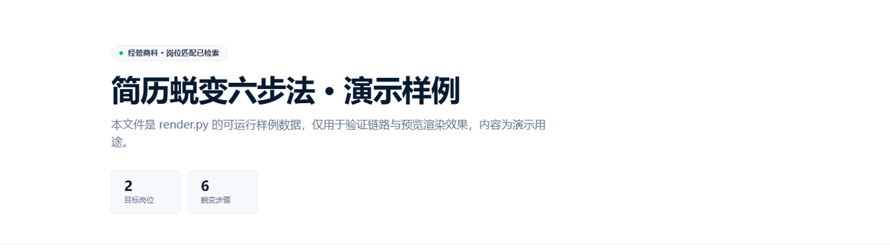
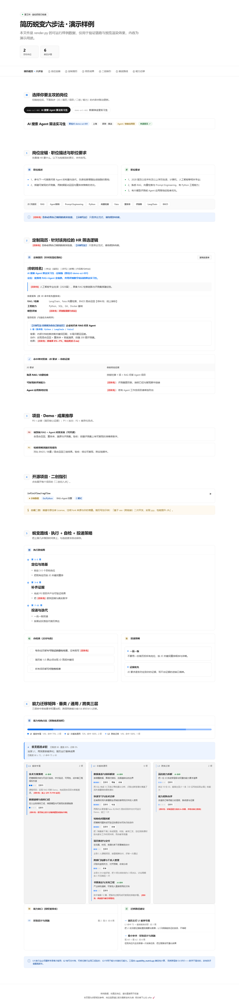
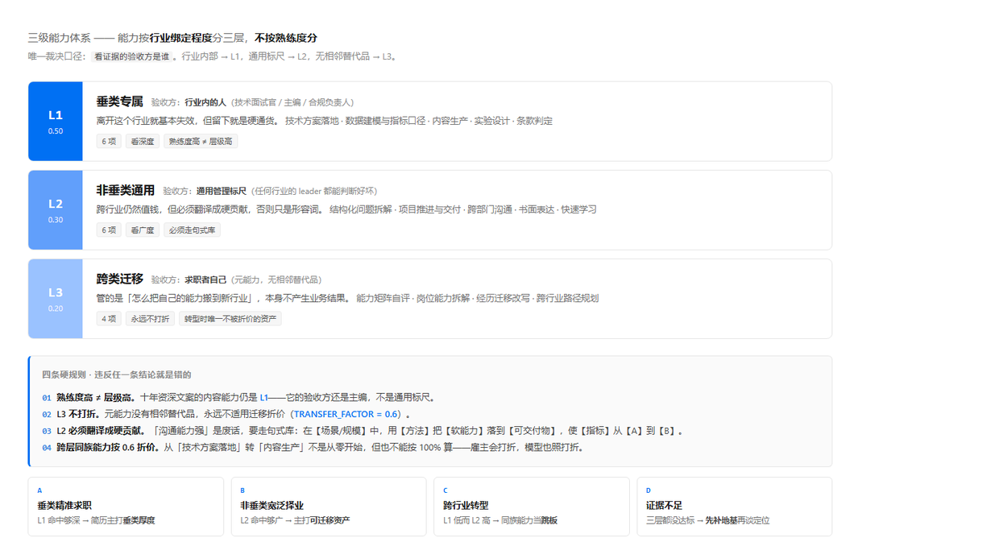
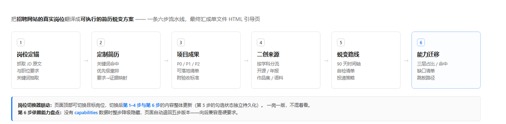
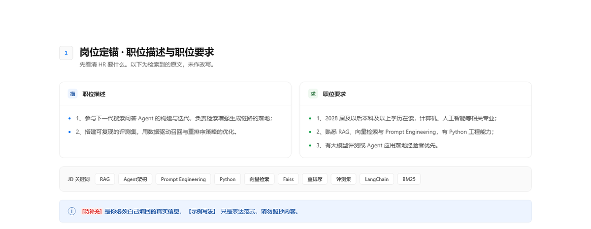
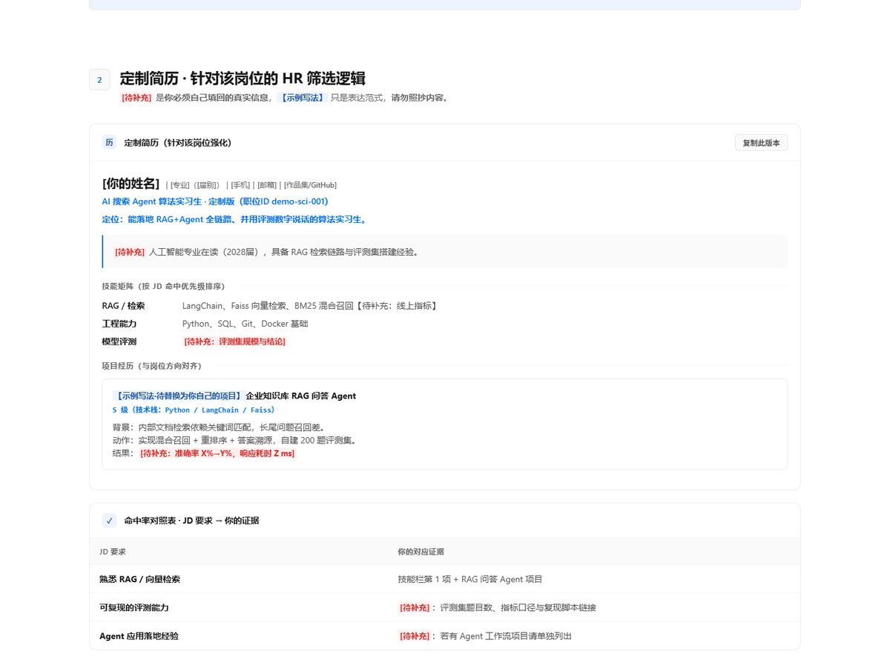
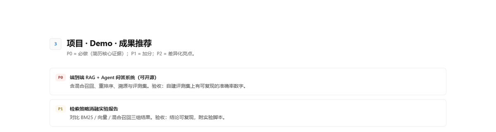
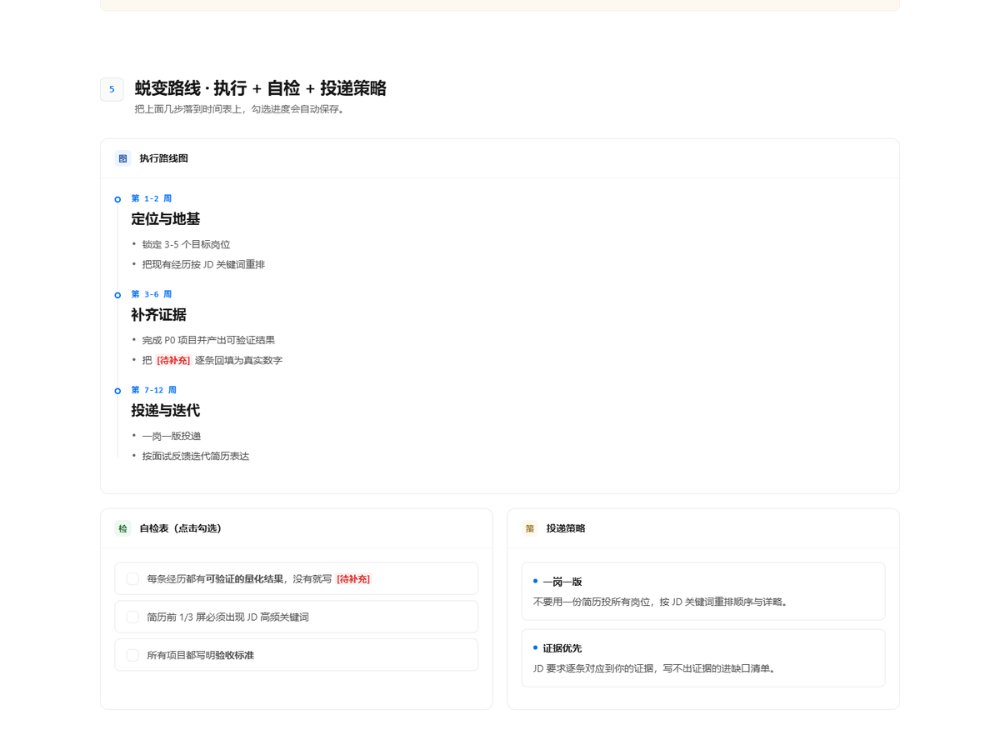
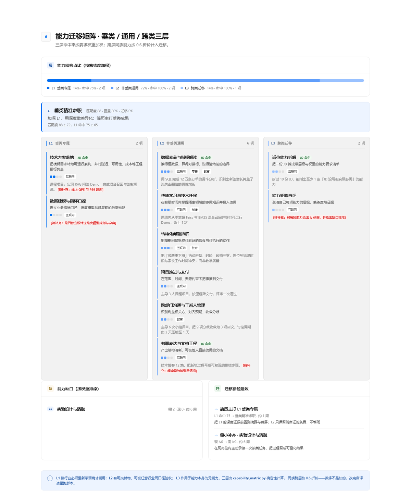

# job-lailailai · 工作岗位速来-引导

> 把**招聘网站的真实岗位 JD**，翻译成**用户可执行的简历蜕变方案**，最终产出一份单文件可视化 HTML 引导页。

[](#-环境要求)
[](#-环境要求)
[](LICENSE)
[](#-跨平台安装)

一个**可移植的 agent skill**：指令用 Markdown，能力用零依赖 Python 脚本。
不绑定任何一家 agent 平台——拷过去就能用。

> **v2.0.0（2026-10-18）**：新增**三级能力体系**（垂类专属 / 非垂类通用 / 跨类迁移）
> 与**第 6 步能力迁移矩阵**，支持垂类精准求职、非垂类宽泛择业、跨行业转型三种场景。
> 老数据仍渲染五步版本，向后兼容。改动明细见 [`CHANGELOG.md`](CHANGELOG.md)。

---

## 目录

- [这是什么](#这是什么)
- [效果预览](#效果预览)
- [三级能力体系](#三级能力体系)
- [六步流水线](#六步流水线)
- [三套设计系统](#三套设计系统)
- [逐步详解](#逐步详解)
- [快速开始](#快速开始)
- [配置说明](#配置说明)
- [调用示例](#调用示例)
- [仓库结构](#仓库结构)
- [常见问题](#常见问题)
- [跨平台安装](#跨平台安装)
- [许可与致谢](#许可与致谢)

---

## 这是什么

先通过岗位需求反哺个人简历，他要什么你给什么。

市面上的「简历优化」工具大多给你一段通用套话。这个 skill 走的是另一条路：

| 通用简历工具 | job-lailailai |
| --- | --- |
| 给你一堆「建议多用动词」的套话 | 抓**真实招聘页的 JD 原文**，逐条建「要求 → 你的证据」映射表 |
| 默认服务理工科 | **文理双轨**：人文社科的岗位同样走招聘站检索，作品集/调研报告/策划案都算有效证据 |
| 靠模型感觉打分 | 岗位匹配打分、能力矩阵计算交给**确定性脚本**，同一输入必须同一分数 |
| 输出一段文本 | 输出**单文件 HTML 引导页**，双击即开，零外部请求 |
| 一套皮肤走天下 | 理工/文科/商科各绑一套**真实设计系统**，切换轨道视觉语言真的会变 |
| 只告诉你「差什么」 | 还算出**能力能迁到哪**：三层命中率、迁移率、最小补齐路径 |
| 只能投本行 | 三种场景都能跑：垂类精准求职 / 非垂类宽泛择业 / **跨行业转型** |

核心承诺：**把用户已有的经历，重写并组织成最贴合目标岗位的表达**，
并算清楚哪些能力是**跨行业也值钱的**。

---

## 效果预览

完整渲染结果（三套设计系统，同一份数据）：

<table>
<tr>
<td width="33%" align="center"><b>sci · 理工科</b><br><sub>Vercel</sub></td>
<td width="33%" align="center"><b>art · 人文社科</b><br><sub>Editorial</sub></td>
<td width="33%" align="center"><b>biz · 经管商科</b><br><sub>Stripe</sub></td>
</tr>
<tr>
<td></td>
<td></td>
<td></td>
</tr>
</table>

整页总览（sci 主题）：



> 想直接在浏览器里点开看？把 `examples/demo.html` 下载下来双击即可。
> 三套主题的在线预览在 [`docs/preview/`](docs/preview/)。

---

## 三级能力体系

这是 v2.0 的核心：能力按**行业绑定程度**分三层，**不是按熟练度分**。



| 层 | 名称 | 谁在验收这份证据 | 例子 |
| --- | --- | --- | --- |
| `L1` | 垂类专属 | **行业内的人**（技术面试官、主编、合规负责人） | 技术方案落地、数据建模与指标口径、内容生产 |
| `L2` | 非垂类通用 | **通用管理标尺**（任何行业的 leader 都能判断好坏） | 结构化问题拆解、项目推进、书面表达 |
| `L3` | 跨类迁移 | **求职者自己**（元能力，无相邻替代品） | 能力矩阵自评、岗位能力拆解、经历迁移改写 |

判定只问一句话：**这份证据的验收方是谁？**

四条规则，违反任一条结论就是错的：

1. **熟练度高 ≠ 层级高**。十年资深文案的内容能力仍是 `L1`——验收方还是主编，不是通用标尺。
2. **`L3` 不打折**。元能力没有相邻替代品，永远不适用迁移折价。
3. **`L2` 必须翻译成硬贡献**。写「沟通能力强」是废话，要走句式库：
   `在【场景/规模】中，用【方法】把【软能力】落到【可交付物】，使【指标】从【A】到【B】。`
4. **跨层同族能力按 0.6 折价**。你从「技术方案落地」转「内容生产」不是从零开始，
   但也不能按 100% 算——雇主会打折，模型也照打折。

三种择业场景由 `profile.intent` 决定判定口径：

| 场景 | `intent` | 判定重点 | 简历该主打什么 |
| --- | --- | --- | --- |
| A 垂类精准求职 | `vertical` | `L1` 命中率够不够深 | 垂类厚度 |
| B 非垂类宽泛择业 | `broad` | `L2` 命中率够不够广 | 可迁移的通用资产 |
| C 跨行业转型 | `switch` | `L1` 低而 `L2` 高即判转型 | 同族能力当跳板 |
| D 证据不足 | 自动 | 三层都没达标 | 先补地基再谈定位 |

完整的判定树、16 项能力目录（每项含能力定义 / 核心可迁移点 / 垂类适配场景 /
非垂类适配场景 / 跨行业应用案例）、五级分级标准与软能力句式库，
见 **[`references/capability-tiers.md`](references/capability-tiers.md)**。

---

## 六步流水线



最终交付一个**单文件 HTML 引导页**：顶部有岗位切换器，切换岗位时第 1–4 步与第 6 步的内容联动更新。

> 老数据（`jobs.json` 里没有 `capabilities`）仍渲染五步版本，与 v1.1 逐字节一致。
> 也可以用 `--no-cap` 显式降级。**向后兼容是硬要求，不是尽力而为。**

---

## 三套设计系统

视觉层由 token 驱动，`render.py` 只写结构、**不写色值**。三个学科轨道各绑一套真实设计系统：

| 轨道 | 设计系统 | 视觉气质 | 为什么选它 |
| --- | --- | --- | --- |
| `sci` 理工科 | **Vercel** | 近白画布 `#fafafa` / 近黑文字 `#171717` / 单一蓝强调 `#0070f3` / 以阴影充当描边 | 工程感的克制表达，贴合技术岗语境 |
| `art` 人文社科 | **Editorial** | 暖纸面 `#fbf7f0` / 衬线标题（Georgia·宋体）/ 赭石强调 `#9a5a2f` | 出版物的编排语言，贴合作品集/调研报告 |
| `biz` 经管商科 | **Stripe** | 白底 / 藏青文字 `#061b31` / 紫罗兰强调 `#533afd` / 多层蓝调投影 | 金融基础设施的专业感 |

选型不是随手挑的：三套系统的**明度层级、字重习惯、投影逻辑互不相同**，
切换轨道时用户能明显感到「这是给另一类岗位做的」，而不是同一套皮换个色。

```bash
# 换主题 = 改一处映射（design_systems.py）
TRACK_SYSTEM = {"sci": "vercel", "art": "editorial", "biz": "stripe"}
```

**改样式前请先读 [`references/design-systems.md`](references/design-systems.md)** ——
首屏渐变光晕、双品牌色、满屏大圆角、到处都有的卡片投影、结构件里的彩色 emoji
都是被**主动去掉**的 AI 味，不要加回来。

第 6 步的三层能力色用的是**同色相三级明度**（`--cap-l1` / `--cap-l2` / `--cap-l3`，
由 `accent` 向 `surface` 按 0 / 30% / 55% 混色派生），不是三个语义色——
因为三层是同一光谱的三段，不是三种无关类型。`design_systems.py` 有自检断言
三档明度必须严格递增，改混色比例跑一次就知道有没有破。

---

## 逐步详解

### 岗位切换器 · 一岗一版


切换岗位后，第 1–4 步与第 6 步整体更新。**一岗一版才有意义**，不要混着看。

### 第 1 步 · 岗位定锚



抓取招聘页正文，抽出 JD 原文与职位要求（**未作改写**），并标注来源、抓取时间、关键词。

### 第 2 步 · 定制简历



技能矩阵**按 JD 关键词命中优先级重排**——HR 初筛只看前 1/3 屏，命中词必须靠前。
下方是「要求 → 你的证据」映射表；写不出证据的条目直接进缺口清单。

页面上两种高亮约定：

- <span style="color:#d33">`[待补充：…]`</span> —— 你必须自己回填的真实信息
- <span style="color:#8250df">`【示例写法】`</span> —— 只是表达范式，**请勿照抄内容**

### 第 3 步 · 项目成果



P0 必做（简历核心证据）/ P1 加分 / P2 差异化。每个项目必须写明**验收标准**，否则无法证明完成。

### 第 5 步 · 蜕变路线



90 天时间轴 + 自检清单 + 投递策略。勾选状态通过 `localStorage` 持久化，刷新不丢。

### 第 6 步 · 能力迁移



四块内容，全部由 `capability_matrix.py` 算出，页面只负责显示（**刻意不在 JS 里做算术**，
两份实现必然漂移）：

1. **三层占比条** —— 你的能力资产在 L1 / L2 / L3 上的分布，三段之和恒为 100%
2. **场景判定** —— A 垂类精准 / B 宽泛择业 / C 跨行业转型 / D 证据不足，附判定理由
3. **三层命中卡片** —— 每项能力的熟练度、行业跨度、是否命中该岗位要求、证据原文
4. **缺口与跳板** —— 最小补齐清单（需 N / 现 M / 约 W 周）+ 迁移路径（从哪到哪、怎么走）

占比条的 `0%` 段是正常的——说明该层你没有能力项，这本身就是有价值的信号。

---

## 快速开始

### 环境要求

| 项 | 要求 |
| --- | --- |
| Python | **>= 3.8**（推荐 3.10+）。命令可能是 `python` / `python3` / `py` |
| 第三方依赖 | **无**。六个脚本全部只用标准库，**不需要也不需要执行 `pip install`** |
| 其他运行时 | 不需要 Node、不需要浏览器。只有做「真实渲染验收」时才需要无头 Chrome（可选） |

> 零依赖是刻意的设计——跨平台迁移最大的坑就是依赖装不上。

### 第 1 步 · 获取

```bash
# 方式 A：git clone
git clone https://github.com/NiuBi66666688/job-lailailai.git
cd job-lailailai

# 方式 B：直接下载 Release 里的迁移包 zip，解压到任意目录
```

### 第 2 步 · 验收

```bash
python verify.py
```

全绿即代表这份包在你机器上完好可用（会跑完六个脚本的自检 + 能力矩阵端到端 +
**三主题**真实渲染冒烟测试 + 五步兼容路径）。
**这一步很关键**：能提前发现 Python 版本、编码、路径等问题，而不是等到真跑业务时才炸。

### 第 3 步 · 落位到 agent 平台

```bash
# 自动探测本机装了哪些平台（只读，不写文件）
python scripts/install.py --detect

# 装到全部探测到的平台（软链模式：改源目录即全平台生效）
python scripts/install.py --target all --link

# 只装某一个平台
python scripts/install.py --target claude-code

# Cursor / Codex 需要 AGENTS.md 指针
python scripts/install.py --target codex --agents-md

# 装到自定义路径（项目级安装 / 未知平台）
python scripts/install.py --target all --dest /path/to/skills
```

装完后在对话里说一句「帮我做求职简历蜕变引导」即可触发。

---

## 配置说明

### `profile.json` · 你的能力底牌

两份用途合一：上半部分是技能标签（供 `match_score.py` 打分），
下半部分是第 4 轮能力盘点结果（供 `capability_matrix.py` 算三层矩阵）。
完整字段定义见 [`references/data-contract.md`](references/data-contract.md)，
可运行样例见 [`examples/profile.sample.json`](examples/profile.sample.json)。

```json
{
  "track": "sci",
  "intent": "broad",
  "targetIndustry": "",
  "skills": ["Python", "RAG", "Faiss", "BM25", "向量检索", "LangChain"],
  "experiences": [
    {"title": "RAG 问答系统", "stack": "Python / Faiss", "result": "召回率提升 18%"}
  ],
  "capabilityMeta": {"assessedAt": "2026-10-18", "method": "self-report-4pt",
                     "catalogVersion": "1.0"},
  "capabilities": [
    {"id": "L1-TECH-BUILD", "name": "技术方案落地", "tier": "L1", "cat": "tech",
     "lv": 2, "scope": ["互联网"], "soft": false,
     "evidence": "实现 RAG 问答 Demo，完成混合召回与答案溯源"},
    {"id": "L2-DATA-LITERACY", "name": "数据素养与指标解读", "tier": "L2", "cat": "data",
     "lv": 3, "scope": ["互联网", "零售", "教育"], "soft": false,
     "evidence": "用 SQL 完成 12 万条订单的漏斗分析"}
  ]
}
```

`capabilities` 的硬约束：**每层至少 1 项、总数 5–16 项**；每个 `lv` 必须有依据；
`soft: true` 的项必须用句式库重写（不接受「沟通能力强」这种无验收标准的表述）。
`id` 只能从 16 项目录取值——见 [`references/capability-tiers.md`](references/capability-tiers.md)。

### `jobs.json` · 岗位数据

每个岗位一条，含 `jd` / `req` / `keywords` / `resume` / `build` / `repos` 六段，
外加 `capabilities`（该岗位的能力要求，分 `must` / `plus`）与 `matrix`（脚本生成的矩阵）。
可直接跑 [`examples/jobs.sample.json`](examples/jobs.sample.json) 试链路。

> ⚠️ **`matrix` 只允许脚本生成，不要手写。** 手写会与 `profile.json` 的自评漂移，
> 导致三层占比、缺口、路径互相矛盾；渲染层只校验形状，写错了不会报错，只会悄悄错。

### `render.py` 可选参数

| 参数 | 作用 |
| --- | --- |
| `--theme sci\|art\|biz` | 指定设计系统与文案语气（默认按 jobs 里的 `track` 自动判定） |
| `--title` / `--subtitle` | 覆盖页面标题与副标题 |
| `--no-repo` | 跳过第 4 步（当二创来源确实检索不到时） |
| `--no-cap` | 跳过第 6 步（当用户确实不做能力盘点时，强制输出五步版本） |

---

## 调用示例

### 命令行 · 确定性工具

```bash
# 1) 岗位匹配打分 —— 确定性、可复现、不烧 token
python scripts/match_score.py --profile profile.json --jobs jobs.json

# 2) 招聘页正文 → 结构化 JD
python scripts/split_jd.py --raw page.txt --out jd.json

# 3) 三级能力矩阵 → 写回 jobs.json 的 jobs[].matrix（第 6 步唯一数据源，必跑）
python scripts/capability_matrix.py --profile profile.json --jobs jobs.json --merge

# 4) 生成单文件 HTML 引导页
python scripts/render.py jobs.json out.html --title "我的求职蜕变方案"

# 5) 数据完整性自检
python scripts/render.py --selftest jobs.json

# 6) 视觉 token 自检（齐全性 + oklab 混色算法 + 三层明度递增）
python scripts/design_systems.py
```

第 3 条不跑，页面第 6 步会整体消失——不是报错，是**静默降级成五步版本**。
想单独看某个岗位的诊断结果，去掉 `--merge` 直接输出到 stdout；
`--scene switch` 可以强制按转型场景判，用来试算「如果我转行会怎样」。

**为什么打分与矩阵必须用脚本而不是让模型判断**：

| 环节 | 交给谁 | 原因 |
| --- | --- | --- |
| 岗位匹配打分、关键词命中 | **`match_score.py`** | 同一输入必须同一分数。模型会漂移（今天 73 明天 68），用户立刻失去信任 |
| JD 切分 | **`split_jd.py`** | 段落识别是规则问题，模型容易过度发挥 |
| 三层占比、命中率、迁移折价、场景判定 | **`capability_matrix.py`** | 占比必须三项和恒为 100（最大余额法），模型算不出这个约束 |
| 能力归属改判、经历改写、二创引导、面试建议 | **大模型** | 这才是真正需要判断力的地方 |

### 对话中 · 交给 agent

装好之后直接说人话即可：

```
帮我做求职简历蜕变引导
```

agent 会按 `SKILL.md` 的流程走：先分轮采集（专业 / 届别 / 技能 / 目标，一轮最多 4 题），
再联网检索真实岗位，再调脚本打分切分，最后渲染 HTML 并截图验证。

也可以更具体：

```
我是 2028 届人文社科本科生，想投新媒体运营和品牌公关。
帮我从招聘网站找 3 个真实岗位，做一份定制简历方案。
```

---

## 仓库结构

```
job-lailailai/
├── SKILL.md                    ← 完整工作流（唯一真源，agent 的入口）
├── AGENTS.md                   ← 给只认 AGENTS.md 的平台做指针（Cursor / Codex）
├── README.md                   ← 本文件：使用说明
├── LICENSE                     ← Apache-2.0
├── NOTICE                      ← 上游 OpenDesign 设计系统的署名
├── CHANGELOG.md                ← 版本记录
├── requirements.txt            ← 依赖声明（零第三方依赖）
├── verify.py                   ← 一键验收（clone 后先跑这个）
│
├── scripts/                    ← 零依赖 Python 工具
│   ├── match_score.py            岗位匹配打分（确定性、可复现）
│   ├── split_jd.py               招聘页正文 → 结构化 JD
│   ├── capability_matrix.py      三级能力矩阵（占比/命中/折价/场景/路径）
│   ├── design_systems.py         视觉层 token（Vercel / Editorial / Stripe）
│   ├── render.py                 生成单文件 HTML 引导页
│   └── install.py                跨平台安装（--detect / --target）
│
├── references/                 ← 按需读的细则
│   ├── search-recipes.md         联网检索配方：引擎分工 + 招聘站 site: 定向
│   ├── track-dimensions.md       文理科能力维度库（只管「怎么练」）
│   ├── capability-tiers.md       三级判定树 + 16 项目录 + 分级标准 + 句式库
│   ├── resume-rules.md           定制简历生成规则
│   ├── rework-matrix.md          P0/P1/P2 项目与二创来源矩阵
│   ├── data-contract.md          jobs.json / profile.json 数据契约
│   ├── design-systems.md         视觉层：token schema / 换主题 / anti-AI-slop 清单
│   ├── verify-render.md          渲染验证方法（含无头 Chrome 实操）
│   └── portability.md            跨平台兼容矩阵与坑位
│
├── examples/
│   ├── jobs.sample.json        ← 可运行样例岗位（2 个，覆盖 sci/art 双轨 + 六步法）
│   ├── profile.sample.json     ← 可运行样例能力自评（10 项，三层齐全）
│   └── demo.html               ← 样例渲染出的单文件页面（sci 主题）
│
└── docs/
    ├── PUBLISH.md              ← 发布上线指南（含每步骤配图要求）
    ├── index.html              ← 预览落地页（GitHub Pages 入口）
    ├── preview/                ← 三主题在线预览页
    │   ├── demo-sci.html
    │   ├── demo-art.html
    │   └── demo-biz.html
    └── images/                 ← README 与 PUBLISH 的配图
```

---

## 常见问题

<details>
<summary><b>平台没自动触发这个 skill？</b></summary>

先 `python scripts/install.py --detect` 确认它落到了被扫描的目录；
也可以在对话里显式 @ 引用，或直接说「按 job-lailailai 的流程做」。
</details>

<details>
<summary><b>Cursor / Codex / 自研 agent 认不出？</b></summary>

它们优先读 `AGENTS.md`。本仓库根目录**已内置** `AGENTS.md`（内容是指针 + 核心要点摘要），
直接用即可；也可以跑 `python scripts/install.py --target codex --agents-md` 生成。
</details>

<details>
<summary><b>Windows 建软链报错？</b></summary>

未开启开发者模式。改用复制模式——去掉 `--link` 参数即可。
</details>

<details>
<summary><b>中文乱码？</b></summary>

Windows 控制台默认 GBK。脚本已强制 UTF-8 输出；若仍乱码先执行 `chcp 65001`。
</details>

<details>
<summary><b>脚本报「找不到文件」？</b></summary>

用了相对路径但 cwd 不对。用绝对路径调用，或先 `cd` 到仓库根目录。
`scripts/` 与 `references/` 的相对路径是写死的，**不要把文件拆散**。
</details>

<details>
<summary><b><code>python</code> 命令不存在？</b></summary>

环境只装了 `python3` 或 `py`。换成 `python3 verify.py` / `py verify.py`。
</details>

<details>
<summary><b>改了颜色但页面没变 / 某个角标还是旧色？</b></summary>

你大概在 `render.py` 里手写了 hex。**颜色只该定义在 `scripts/design_systems.py`**，
`render.py` 里一律 `var(--token)`。手改会让三个主题各自漂移，且下次渲染被覆盖。
要新颜色先在 token 层派生，细则见 [`references/design-systems.md`](references/design-systems.md)。
</details>

<details>
<summary><b>我想让页面更「漂亮」一点，加点渐变和圆角？</b></summary>

先读 [`references/design-systems.md`](references/design-systems.md) 第四节的「有意不做的事」。
首屏渐变光晕、双品牌色、满屏大圆角、到处投影都是被**主动去掉**的 AI 味。
「更漂亮」在本项目里的含义是**更克制**，不是加装饰。
</details>

<details>
<summary><b>怎么确认渲染真的没问题，而不是「应该能跑」？</b></summary>

按 [`references/verify-render.md`](references/verify-render.md) 用无头 Chrome 截图肉眼确认。
`--virtual-time-budget` 不推进 CSS transition，截图半透明是假象，不是代码问题。
</details>

<details>
<summary><b>页面只有五步，没有「能力迁移」？</b></summary>

三个原因，按可能性排序：

1. **没跑 `capability_matrix.py --merge`** —— 最常见。第 6 步的数据源是 `jobs[].matrix`，
   没有它页面就退回五步，且**不会报错**。
2. `jobs.json` 里没有任何岗位带 `capabilities`（或 `must` / `plus` 都是空的）。
3. 渲染时加了 `--no-cap`。
</details>

<details>
<summary><b>我的能力到底算 L1 还是 L2？</b></summary>

只问一句：**这份证据的验收方是谁？**

- 行业内部的人能判断好坏（技术面试官看架构、主编看选题、合规看条款）→ `L1`
- 任何行业的 leader 都能判断好坏（事情拆得清不清楚、项目推得动不动、文档写得顺不顺）→ `L2`

最容易错的两种：

- **「跨 3 个行业协调过团队」仍是 `L2`** —— 验收方还是通用管理标尺，不是行业专家。
- **「做了十年文案」仍是 `L1`** —— 熟练度高不等于层级高，层级看的是绑定程度。

拿不准时查 [`references/capability-tiers.md`](references/capability-tiers.md) 的「易混淆情形判定表」。
</details>

<details>
<summary><b>为什么我不能直接改 <code>matrix</code> 里的数字？</b></summary>

因为它是 `capability_matrix.py` 的输出。手改必然与 `profile.json` 的自评漂移，
页面上的三层占比、缺口清单、迁移路径会互相矛盾——但**渲染层只校验形状，
写错了不会报错，只会悄悄错**。要改结论就改输入（`profile.json` 或 `capabilities`），重跑脚本。
</details>

<details>
<summary><b>岗位数据是真的吗？</b></summary>

来自联网检索，每个岗位记录 `url` / `source` / `fetchedAt`。
查不到的会写「未检索到，需人工确认」，**不会把没找到的岗位写成找到了**。
`examples/jobs.sample.json` 是**演示假数据**，只用于验证渲染链路。
</details>

---

## 跨平台安装

本 skill 是**通用格式**，不绑定任何平台：指令用 Markdown、能力用零依赖 Python 脚本，
这两样在所有主流 agent 上都能跑。差异只在入口文件名。

| 平台 | 入口 | 默认位置 |
| --- | --- | --- |
| WorkBuddy | `SKILL.md` | `~/.workbuddy-ai/skills/<name>/` |
| Claude Code | `SKILL.md` | `~/.claude/skills/<name>/` |
| Qoder CN | `SKILL.md` | `~/.qoder/skills/<name>/` |
| Cursor | `AGENTS.md` | 项目根 `/.cursor/rules/` |
| Codex | `AGENTS.md` | 项目根 / `~/.codex/` |

**换平台不影响行为**，因为重活都交给了脚本：打分、JD 切分、能力矩阵都是确定性代码，
agent 只负责理解意图与改写表达。更多坑位见 [`references/portability.md`](references/portability.md)。

---

## 发布上线

想知道这个仓库是怎么从本地源码推到 GitHub 的、每一步需要什么账号与前置条件、
每个步骤该配什么图？见 **[`docs/PUBLISH.md`](docs/PUBLISH.md)**。

---

## 许可与致谢

- 本项目代码：**Apache-2.0**，见 [`LICENSE`](LICENSE)。
- 三套设计系统 token 取自 [nexu-io/open-design](https://github.com/nexu-io/open-design)
  的 `design-systems/{vercel,editorial,stripe}/`，许可 **Apache-2.0**，
  完整署名见 [`NOTICE`](NOTICE)。本地适配与上游的差异记录在
  `scripts/design_systems.py` 文件头与 [`references/design-systems.md`](references/design-systems.md)。
- Vercel / Editorial / Stripe 是各自权利人的商标，此处仅用于指代设计语言来源。
