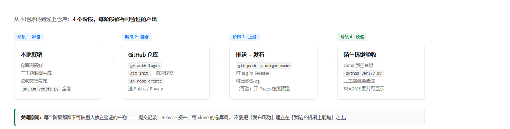

# 发布上线指南 · GitHub

把本仓库从本地源码推到 GitHub，并发布一个带迁移包的 Release。

面向**第一次做开源发布**的人：每一步都写清楚「要做什么、需要什么、怎么验证、配什么图」。

> **本文的实例仓库**：<https://github.com/NiuBi66666688/job-lailailai>
>
> 下文所有命令里的 `<owner>` 都替换成你的 GitHub 账号名。
> 想先看结果长什么样，直接打开上面这个地址——它就是按本文流程发布出来的，
> 包括 README 配图、`docs/PUBLISH.md`、Release 附件和 Pages 在线预览。
> 最终形态参考：[仓库首页](https://github.com/NiuBi66666688/job-lailailai) ·
> [Release v2.0.0](https://github.com/NiuBi66666688/job-lailailai/releases/tag/v2.0.0) ·
> [Pages 预览](https://niubi66666688.github.io/job-lailailai/)

---

## 目录

- [一、前置条件](#一前置条件)
- [二、发布流程总览](#二发布流程总览)
- [三、分步操作](#三分步操作)
- [四、每步骤配图要求](#四每步骤配图要求)
- [五、发布后校验](#五发布后校验)
- [六、可选增强](#六可选增强)
- [七、常见问题](#七常见问题)

---

## 一、前置条件

### 1.1 账号

| 项 | 要求 | 怎么确认 |
| --- | --- | --- |
| GitHub 账号 | 已注册并完成邮箱验证 | 能正常登录 github.com |
| 仓库权限 | 能创建仓库（个人账号默认可以） | 右上角 `+` → `New repository` 能打开 |
| 账号名 | 本指南用 `<owner>` 占位，例如 `NiuBi66666688` | `gh api user --jq .login` |

> **不要**把 token、密码、私钥写进仓库。本文所有命令都用交互式登录或系统钥匙串。

### 1.2 本机工具

| 工具 | 版本 | 检查命令 | 说明 |
| --- | --- | --- | --- |
| Git | >= 2.28 | `git --version` | 2.28+ 才有 `init.defaultBranch` |
| GitHub CLI（可选但强烈推荐） | >= 2.0 | `gh --version` | 用它可以一条命令建仓 + 推送，省掉手工配 remote |
| Python | >= 3.8 | `python --version` | 跑 `verify.py` 验收用 |

装 `gh`：

```bash
# macOS
brew install gh
# Windows
winget install --id GitHub.cli
# Debian/Ubuntu
sudo apt install gh
```

### 1.3 仓库就绪（本地必须先自检通过）

```bash
cd job-lailailai
python verify.py
```

**必须全绿再往下走。** 这一步会跑完五个脚本的自检 + 三主题真实渲染冒烟测试。
本地都不通过，推上去只会让别人替你发现同一个问题。

### 1.4 首次使用 gh 需要登录

```bash
gh auth login
```

交互选项推荐：

| 问题 | 选 |
| --- | --- |
| What account do you want to log into? | `GitHub.com` |
| Preferred protocol for Git operations? | `HTTPS` |
| Authenticate Git with your GitHub credentials? | `Yes` |
| How would you like to authenticate? | `Login with a web browser` |

验证：

```bash
gh auth status
gh api user --jq .login
```

---

## 二、发布流程总览



| 阶段 | 你要做的事 | 产出（可被别人独立验证） |
| --- | --- | --- |
| **1 · 准备** | 仓库树整理好、配图生成、文档写完、`verify.py` 全绿 | 本地干净的工作树 |
| **2 · 建仓** | `git init` + 首次提交 + `gh repo create` | GitHub 上存在一个空仓库 |
| **3 · 上线** | `git push -u origin main` + 打 tag 发 Release | 线上可 clone 的仓库树 + Release 资产 |
| **4 · 校验** | clone 到**空目录**重跑 `verify.py`，检查 README 图片 | 陌生人视角的验收结论 |

> **关键原则**：不要把「发布成功」建立在「我这台机器上能跑」之上。
> 第 4 阶段必须在**新目录**里做，复用本地目录等于没测。

---

## 三、分步操作

### 步骤 1 · 准备本地仓库树

确认目录结构符合 [README 的「仓库结构」](../README.md#仓库结构) 一节。
三个必须存在的文件：

| 文件 | 作用 | 缺了会怎样 |
| --- | --- | --- |
| `README.md` | GitHub 首页展示的内容 | 首页空白，没人知道这是干什么的 |
| `LICENSE` | 声明授权方式 | GitHub 会标「无许可证」，企业用户不敢用 |
| `.gitignore` | 排除缓存/临时文件 | `__pycache__`、截图临时文件被误提交 |

生成 `.gitignore`（如果还没有）：

```bash
cat > .gitignore <<'EOF'
__pycache__/
*.py[cod]
.venv/
venv/
_probe*.html
_verify_out.html
*.log
.DS_Store
Thumbs.db
EOF
```

**验证**：`git status --short` 不应该列出 `__pycache__` 之类的文件。

---

### 步骤 2 · 初始化 Git 并首次提交

```bash
git init -b main
git add .
git status --short          # 先看一眼将提交什么
git commit -m "feat: job-lailailai 求职简历蜕变引导 v2.0.0

可移植 agent skill：把招聘网站真实岗位 JD 翻译成可执行的简历蜕变方案。
- 六步流水线：岗位定锚 → 定制简历 → 项目成果 → 二创来源 → 蜕变路线 → 能力迁移
- 三级能力体系：垂类专属 L1 / 非垂类通用 L2 / 跨类迁移 L3（按验收方判定）
- 三套设计系统：sci/Vercel · art/Editorial · biz/Stripe（token 驱动）
- 零第三方依赖，六个 Python 脚本 + 九份细则文档
- 跨平台：WorkBuddy / Claude Code / Cursor / Codex / Qoder"
```

首次使用 Git 的话，先设身份：

```bash
git config --global user.name  "你的名字"
git config --global user.email "你的邮箱"
```

**验证**：`git log --oneline` 应该只有一条记录；`git status` 显示 `working tree clean`。

---

### 步骤 3 · 创建远程仓库

**方式 A · 用 gh（推荐，一条命令）**

```bash
gh repo create job-lailailai --public --source=. --remote=origin --push
```

- `--public` 换成 `--private` 就是私有仓库
- `--source=.` 表示用当前目录作为源
- `--push` 会顺带把 `main` 推上去

**方式 B · 网页创建 + 手工配 remote**

1. 打开 <https://github.com/new>
2. Repository name 填 `job-lailailai`
3. 选 Public / Private
4. **不要**勾 "Add a README file"、不要加 .gitignore、不要选 license（本地已有，勾了会冲突）
5. 点 `Create repository`
6. 回到本地：

```bash
git remote add origin https://github.com/<owner>/job-lailailai.git
git push -u origin main
```

**验证**：`gh repo view --web` 能打开仓库页，且文件列表与本地一致。

---

### 步骤 4 · 发布 Release（附迁移包）

Release 让使用者能**下载一个压缩包直接用**，不必 clone。

先本地打包：

```bash
python verify.py                     # 打 Release 前再验一次
# 若有打包脚本
python build/pack.py                 # 产出 dist/job-lailailai-portable-<版本>-<日期>.zip
```

再发布：

```bash
VERSION=2.0.0
gh release create "v$VERSION" \
  "dist/job-lailailai-portable-$VERSION-*.zip" \
  --title "v$VERSION · 三级能力体系 + 能力迁移矩阵" \
  --notes-file docs/RELEASE_NOTES.md
```

`docs/RELEASE_NOTES.md` 建议结构：

```markdown
## 新增
- 三级能力体系（垂类专属 L1 / 非垂类通用 L2 / 跨类迁移 L3），按「谁在验收」判定
- 第 6 步能力迁移矩阵：三层占比 / 命中率 / 缺口 / 跳板路径，由确定性脚本算出

## 修复
- `render.py` 用 `abs(hash())` 做 localStorage key，重渲染后勾选进度会丢
- `data-contract.md` 漏记 `jobs[].major` / `jobs[].grade`

## 兼容
- 老数据（无 `capabilities`）仍渲染五步版本，与 v1.1 逐字节一致

## 安装
见 README 的「快速开始」一节。
```

**验证**：`gh release list` 能看到新版本；网页上 Release 资产能下载，且解压后 `python verify.py` 全绿。

---

## 四、每步骤配图要求

一份「图文并茂」的说明，配图要**服务于理解**，不是装饰。以下是每个步骤该配什么图。

### 4.1 配图总表

| 步骤 | 图名 | 类型 | 拍什么 | 关键要求 |
| --- | --- | --- | --- | --- |
| 1 · 准备 | `flow-release.png` | 流程图 | 四阶段总览 | 已内置，见 `docs/images/` |
| 1 · 准备 | `repo-tree.png` | 目录树截图 | 编辑器侧边栏或 `tree` 输出 | 展开 `scripts/`、`references/`；**遮掉本地绝对路径里的用户名** |
| 2 · 建仓 | `terminal-git-init.png` | 终端截图 | `git init` → `git add` → `git commit` 的输出 | 宽度 ≥ 100 字符，字号调大到 16px+，深色底更清晰 |
| 2 · 建仓 | `verify-green.png` | 终端截图 | `python verify.py` 全绿输出 | **这张最重要**，是「可复现」的证据。别裁掉结尾的汇总行 |
| 3 · 上线 | `github-new-repo.png` | 网页截图 | GitHub 新建仓库表单 | 高亮 `Repository name` 与 Public/Private 选择；**遮掉账号邮箱** |
| 3 · 上线 | `github-repo-home.png` | 网页截图 | 推送后的仓库首页 | 要能同时看到 README 渲染、文件列表、About 栏 |
| 4 · 发布 | `github-release.png` | 网页截图 | Release 页面 | 要露出资产文件名与大小，证明 zip 确实附上了 |
| 4 · 发布 | `readme-images-ok.png` | 网页截图 | README 里的配图正常显示 | 证明图片路径没写错（这是最常见的翻车点） |

### 4.2 产品配图（已内置）

以下图已在 `docs/images/` 里，由 `render.py` 真实渲染后截图生成，**不需要手工拍**：

| 图名 | 内容 |
| --- | --- |
| `flow-pipeline.png` | 六步流水线 |
| `flow-tiers.png` | 三级能力体系（L1/L2/L3 与验收方） |
| `hero-sci.png` / `hero-art.png` / `hero-biz.png` | 三套设计系统首屏对比 |
| `full-sci.png` | sci 主题整页总览 |
| `shot-switcher.png` | 岗位切换器 |
| `shot-step1.png` ~ `shot-step6.png` | 六个步骤的分区截图 |

重新生成它们：

```bash
# 0) 先算三级能力矩阵（不跑这步，第 6 步不会出现）
python scripts/capability_matrix.py --profile examples/profile.sample.json \
       --jobs examples/jobs.sample.json --merge --out /tmp/jobs.json

# 1) 渲染三主题页面
python scripts/render.py /tmp/jobs.json docs/preview/demo-sci.html --theme sci
python scripts/render.py /tmp/jobs.json docs/preview/demo-art.html --theme art
python scripts/render.py /tmp/jobs.json docs/preview/demo-biz.html --theme biz

# 2) 起本地服务后用无头 Chrome 截图
#    具体命令与坑位见 references/verify-render.md
```

### 4.3 配图通用规范

| 项 | 建议 |
| --- | --- |
| 格式 | UI 截图用 PNG；照片类才用 JPG。**不要**用 WebP（GitHub 兼容但老客户端会挂） |
| 宽度 | 1200px 左右。超过 1600px 在 README 里会被压缩，反而看不清 |
| 存放 | 统一放 `docs/images/`，README 用**相对路径**引用 |
| 引用写法 | `` |
| 替代文本 | **必须写**。图片加载失败时靠它，屏幕阅读器也靠它 |
| 隐私 | 截图前关掉浏览器书签栏、通知；**遮掉**用户名、邮箱、token、公司内部域名 |
| 对比排版 | 并排对比用 HTML `<table>`，比 Markdown 表格更能控宽度 |

---

## 五、发布后校验

**必须在空目录里做**，不要复用本地仓库：

```bash
cd /tmp
git clone https://github.com/<owner>/job-lailailai.git fresh
cd fresh
python verify.py
```

| 检查项 | 期望 | 不通过怎么办 |
| --- | --- | --- |
| clone 成功 | 无报错 | 检查仓库可见性与网络 |
| `verify.py` 全绿 | 9 项全过 | 说明有文件漏提交，对照 `git ls-files` 排查 |
| 三主题渲染 | sci / art / biz 各出一份 HTML | 检查 `design_systems.py` 是否被完整提交 |
| README 图片显示 | 三张 hero 图正常渲染 | 路径大小写、相对位置；GitHub 是**大小写敏感**的 |
| Release 资产 | 能下载且解压后可用 | 重新 `gh release upload` |

浏览器里再扫一遍：

- 打开仓库首页，README 是否正常渲染（表格、图片、折叠块）
- 点 About 栏右侧的 ⚙️，补上 Description 和 Topics（`agent-skill`、`resume`、`job-search`、`python`）

---

## 六、可选增强

### 6.1 开启 GitHub Pages 在线预览

让 README 里的「在线预览」真正可点。

1. 仓库 → `Settings` → `Pages`
2. Source 选 `Deploy from a branch`
3. Branch 选 `main`，文件夹选 `/docs`
4. Save，等 1–2 分钟

访问 `https://<owner>.github.io/job-lailailai/`，
`docs/index.html` 是三主题预览的落地页。

> 页面里的链接**必须是相对路径**，因为 Pages 部署在子路径下，
> 绝对路径 `/preview/demo-sci.html` 会 404。

### 6.2 加 CI 自动验收

`.github/workflows/verify.yml`：

```yaml
name: verify
on: [push, pull_request]
jobs:
  test:
    runs-on: ubuntu-latest
    strategy:
      matrix:
        python-version: ["3.8", "3.11", "3.13"]
    steps:
      - uses: actions/checkout@v4
      - uses: actions/setup-python@v5
        with:
          python-version: ${{ matrix.python-version }}
      - run: python verify.py
```

这样每次 push 都会在三个 Python 版本上自动跑验收，README 也能挂个绿色徽章。

### 6.3 补 About 栏

仓库首页右上角 ⚙️：

| 字段 | 建议值 |
| --- | --- |
| Description | 把招聘网站真实岗位 JD 翻译成可执行的简历蜕变方案 · 可移植 agent skill |
| Website | Pages 地址（如果开了） |
| Topics | `agent-skill` `resume` `job-search` `career` `python` `claude-code` `skill` |

---

## 七、常见问题

<details>
<summary><b>push 被拒：<code>remote contains work that you do not have locally</code></b></summary>

建仓时勾了 "Add a README file"。要么先 `git pull --rebase origin main` 合并，
要么删掉远程仓库重建，**建仓时不要勾任何初始化文件**。
</details>

<details>
<summary><b>push 报认证失败 / 要求输入密码</b></summary>

GitHub 已停用密码推送。用 `gh auth login` 走浏览器授权，
或配 SSH key 并把 remote 改成 `git@github.com:<owner>/job-lailailai.git`。
</details>

<details>
<summary><b>README 里的图片不显示（红叉）</b></summary>

按可能性排查：

1. **大小写**：GitHub 区分大小写，本地 Windows 不区分。`Images/` ≠ `images/`
2. **路径基准**：README 里的相对路径是相对 **README 所在目录**的，不是仓库根
3. **文件没提交**：`git ls-files docs/images/` 确认图片真的在版本控制里
4. **文件名带空格或中文**：改成 ASCII 文件名
</details>

<details>
<summary><b>提交里混进了 <code>__pycache__</code> 或临时文件</b></summary>

```bash
git rm -r --cached __pycache__
echo "__pycache__/" >> .gitignore
git commit -m "chore: 忽略 __pycache__"
```
</details>

<details>
<summary><b>想改仓库名或可见性</b></summary>

`Settings` → 最下方 `Danger Zone`：

- `Change repository visibility` —— Public ↔ Private
- `Rename this repository` —— 改名后 GitHub 会自动做旧地址重定向，
  但**本地 remote 要手工更新**：`git remote set-url origin <新地址>`
</details>

<details>
<summary><b>Release 资产太大传不上去</b></summary>

单个文件上限 2 GB，Release 总大小无硬限制但不建议超 1 GB。
本项目的迁移包约 95 KB，完全不用担心。
</details>

<details>
<summary><b>许可证该怎么选</b></summary>

本项目用 **Apache-2.0**，原因是它内嵌了来自 OpenDesign 的 Apache-2.0 设计系统 token，
许可保持一致最省事，且 Apache-2.0 带专利授权，企业用户更放心。
换许可证前先确认[上游许可条款](https://github.com/nexu-io/open-design)允许。
</details>

---

## 附：一页速查

```bash
# ── 准备 ──────────────────────────────────────────
cd job-lailailai
python verify.py                    # 必须全绿

# ── 建仓 ──────────────────────────────────────────
gh auth login                       # 首次
git init -b main
git add .
git commit -m "feat: job-lailailai v2.0.0"
gh repo create job-lailailai --public --source=. --remote=origin --push

# ── 上线 ──────────────────────────────────────────
git push -u origin main
python build/pack.py
gh release create v2.0.0 dist/*.zip --title "v2.0.0" --notes-file docs/RELEASE_NOTES.md

# ── 校验（务必在空目录） ───────────────────────────
cd /tmp && git clone https://github.com/<owner>/job-lailailai.git fresh
cd fresh && python verify.py
```
